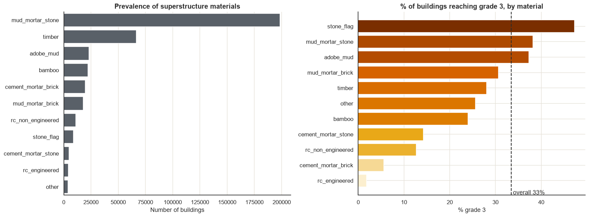
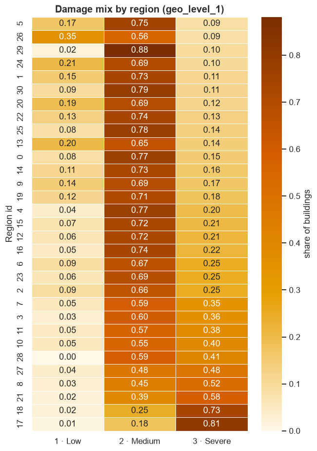
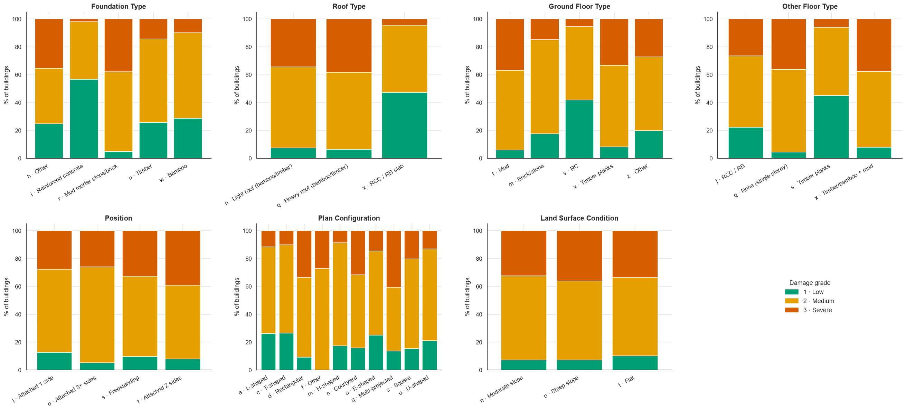
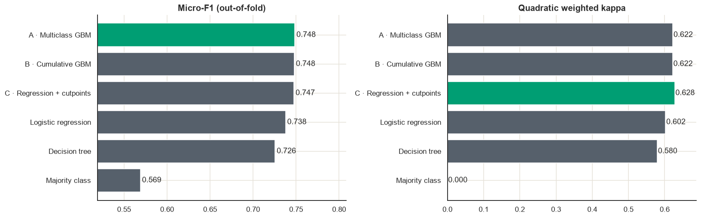
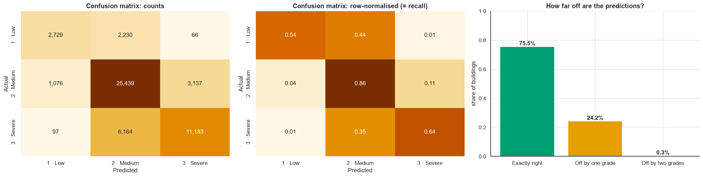
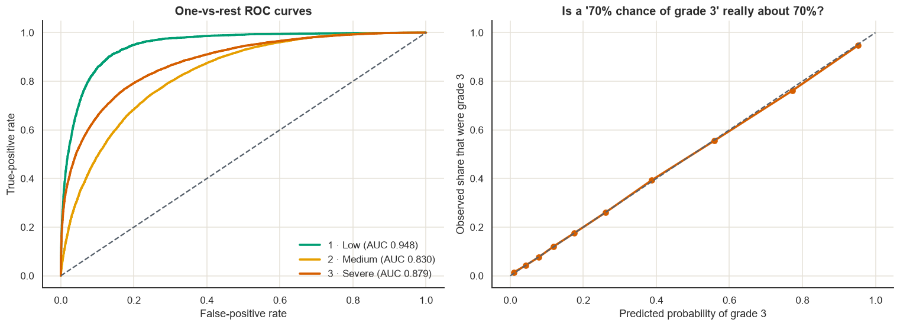
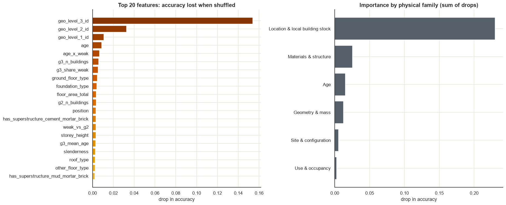
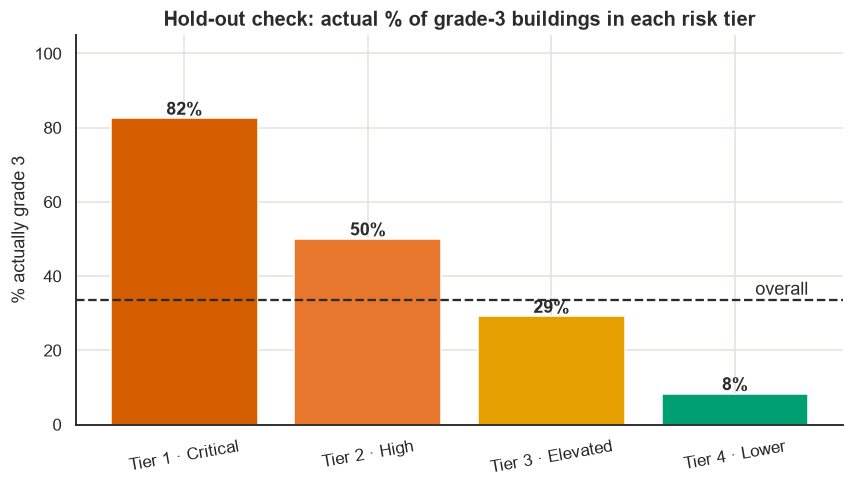

# Earthquake-Damage-Prediction
Ordinal classification of 2015 Nepal earthquake building damage from a 260k-building survey. Leak-proof pipeline, out-of-fold geo target encoding, multiclass vs cumulative-ordinal gradient boosting. 75.5% hold-out accuracy, calibrated probabilities, and validated risk tiers for inspection prioritisation. Python, scikit-learn.
# Earthquake Damage Prediction: Nepal 2015

Ordinal classification of building damage from the 2015 Gorkha earthquake, with a risk-tiered inspection list for disaster-response planning.

  

---

## Executive Summary

After the April 2015 Gorkha earthquake (Mw 7.8), surveyors recorded the damage grade of 260,601 buildings in Nepal: **1 (low), 2 (medium) or 3 (near-complete destruction)**. This project builds a model that estimates a building's damage grade from its location, structure, size, age and use, and converts the output into a **ranked, risk-tiered priority list** for inspection and retrofit planning.

**Business question:** given where a building stands and how it was built, how likely is it to suffer severe damage, and which buildings should be inspected first?

| Metric (52,121 unseen buildings) | Model | Naive baseline |
|---|---|---|
| Exact damage grade (3-class accuracy, micro-F1) | **0.755** | 0.569 |
| Severe vs not severe (binary accuracy) | **0.818** | 0.665 |
| ROC-AUC (one-vs-rest, macro) | **0.886** | n/a |
| Quadratic weighted kappa | **0.629** | 0.000 |
| Severe buildings predicted as low damage | **0.6%** | n/a |
| Grade-3 share of buildings in Tier 1 vs Tier 4 | **82.5% vs 8.3%** | 33.5% overall |

Cross-validated micro-F1 is 0.750 ± 0.002 against 0.755 on the hold-out, so there is no evidence of overfitting.

---

## Dataset

- **Source:** Kathmandu Living Labs and the Central Bureau of Statistics (Nepal National Planning Commission), distributed through the DrivenData competition [Richter's Predictor: Modeling Earthquake Damage](https://www.drivendata.org/competitions/57/nepal-earthquake/).
- **Size:** 260,601 labelled buildings, 38 features (geography at three levels, structure, materials, size, age, use).
- **Target:** `damage_grade`, an **ordinal** variable (1 < 2 < 3). Class mix: 9.6% / 56.9% / 33.5%.
- The data is not included in this repository. Follow the competition's data terms.

---

## Methodology

### 1. Data quality
- No missing values or duplicate IDs. 16,191 rows share identical feature values but are distinct buildings, so they were retained.
- `age` contains survey placeholders (995 for 1,390 buildings, 200 for 106). These were set to missing with an `age_unknown` indicator. Gradient-boosted trees handle missing values natively, so no imputation was applied.
- 20,862 buildings (8%) record zero families. These were kept and flagged.

### 2. Exploratory analysis
Damage was examined against materials, structural configuration, geometry, age and geography. The strongest signals were superstructure material and location (see Results).

### 3. Feature engineering
Domain-driven features expressing structural-engineering mechanisms: storey height, slenderness (height / footprint), floor area as a mass proxy, weak-masonry and reinforced-concrete indicators, heavy-roof-on-weak-walls interaction, plan irregularity, attachment to neighbours, steep-site indicator, age interacting with weak materials, and label-free neighbourhood statistics per district and village (building count, mean height, mean age, share of weak masonry).

### 4. Validation design
- Stratified 80/20 split. The 20% hold-out (52,121 buildings) was untouched until the final evaluation.
- All model selection used stratified 5-fold cross-validation on the 80% development set, with out-of-fold predictions.
- Every learned transformation sits inside a scikit-learn `Pipeline`, so nothing leaks across folds.

### 5. Handling high-cardinality geography
The data contains 31 regions, 1,414 districts and 11,595 villages. District and village IDs were encoded with a custom **out-of-fold, smoothed target encoder** using two ordinal targets (P(grade >= 2) and P(grade = 3)). Each training row is encoded from other folds only, and sparse locations shrink towards the global mean. Region and the remaining categorical features are passed natively to the gradient-boosted trees.

### 6. Models compared (identical folds and pipeline)
| Model | Role |
|---|---|
| Majority class | Floor |
| Logistic regression | Linear benchmark |
| Decision tree | Interpretable benchmark |
| **A. Multiclass gradient boosting** | Standard multiclass |
| **B. Cumulative (Frank and Hall) gradient boosting** | Ordinal: models P(y >= 2) and P(y = 3) and recombines them |
| **C. Regression with learned cut-points** | Ordinal: continuous score with two optimised thresholds |

### 7. Tuning and decision rule
Randomised search on a subsample (top configurations were within noise at 0.740-0.741, indicating a plateau, so a faster configuration of equal accuracy was chosen). Two multiplicative class weights were learned on out-of-fold probabilities, and a **blend of A and B** was selected on cross-validated micro-F1 (QWK as tie-break).

### 8. Evaluation
Micro-F1, macro-F1, per-class precision and recall, balanced accuracy, MCC, quadratic weighted kappa, MAE in grades, severe-to-low error rate, ROC-AUC, log-loss and calibration, each reported against a naive baseline.

---

## Results

### Material vulnerability
Weak masonry types are heavily over-represented in severe damage, while engineered reinforced concrete rarely reaches grade 3.



### Geographic variation
The share of grade-3 buildings ranges from below 10% in some regions to over 80% in Region 17. No ground-motion data was available, so location acts as a proxy for shaking intensity and site effects.



### Construction characteristics
Foundation, roof, floor type, plan configuration and attachment each shift the damage mix.



### Model comparison (5-fold out-of-fold)
The three boosted models are statistically tied on micro-F1 (0.747-0.749, sd about 0.001). The ordinal regression variant has the best QWK (0.628) and grade-3 recall (0.650). Logistic regression is within about one point (0.738), which indicates that most of the signal comes from the engineered features and geography encoding, not model capacity.



### Error structure on the hold-out
75.5% of predictions are exact, 24.2% are one grade off and 0.3% are two grades off, so the model respects the ordinal structure of the target.



### Discrimination and calibration
One-vs-rest AUC is 0.948 (grade 1), 0.830 (grade 2) and 0.879 (grade 3). The grade-3 reliability curve follows the diagonal closely, so predicted probabilities can be read as probabilities.



### Feature importance (permutation, hold-out)
Location and local building stock dominate, followed by materials, age and geometry.



### Risk-tier validation
Buildings were assigned to tiers by predicted P(grade 3). On unseen buildings, the observed grade-3 rate falls monotonically from 82.5% (Tier 1) to 8.3% (Tier 4).



| Tier | P(grade 3) | Buildings | Share | Observed grade 3 |
|---|---|---|---|---|
| Tier 1, Critical | >= 60% | 11,854 | 22.7% | 82.5% |
| Tier 2, High | 40-60% | 5,876 | 11.3% | 50.0% |
| Tier 3, Elevated | 20-40% | 9,052 | 17.4% | 29.1% |
| Tier 4, Lower | < 20% | 25,339 | 48.6% | 8.3% |

Inspecting Tiers 1 and 2 (34% of buildings) reaches roughly 73% of all grade-3 buildings, and adding Tier 3 reaches roughly 88%.

---

## Deliverables

The notebook exports, per building: ID, predicted grade, probability of each grade, expected grade, risk tier and priority rank. It also exports a priority inspection list, a Tier 1 list, per-grade ID lists and a district hotspot summary.

---

## Limitations

- The labels come from a single event, and the model does not forecast future earthquakes.
- No ground-motion, soil or construction-quality variables are available, and damage grades are visual survey judgements. Around 75-76% exact accuracy appears to be the practical ceiling for this data.
- Tier 4 still contains about 8% grade-3 buildings, so low predicted risk does not imply safety.
- Categorical code meanings were compiled from secondary sources and should be verified against the official codebook.
- The model supports prioritisation and does not replace engineering assessment.

## Possible extensions
Additional boosted-tree libraries (LightGBM, CatBoost) in the blend, a parent-district fallback for sparsely surveyed villages, and seed averaging.

---

## Reproducibility

```
├── Earthquake_Damage_Prediction_ML_Project.ipynb   # full analysis
├── images/                                         # figures used in this README
└── README.md
```

1. Download `train_values.csv` and `train_labels.csv` from the competition page.
2. Set `DATA_DIR` in the setup cell of the notebook.
3. `pip install pandas numpy scikit-learn matplotlib seaborn plotly`
4. Set `QUICK_MODE = True` for a fast test run, or `False` for the full run.

Random seed fixed at 42.

**Tech stack:** Python, pandas, NumPy, scikit-learn (HistGradientBoosting, pipelines, cross-validation), matplotlib, seaborn, plotly.

---

**Author:** Priscilla Kanaparthi
